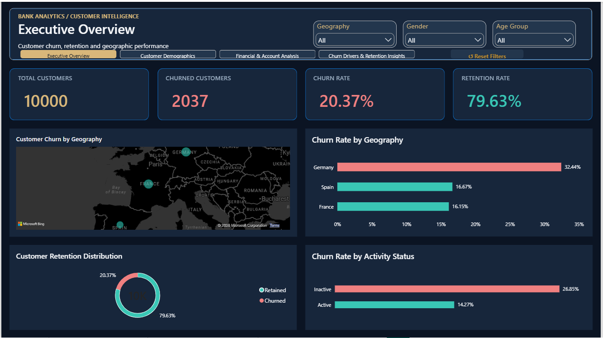
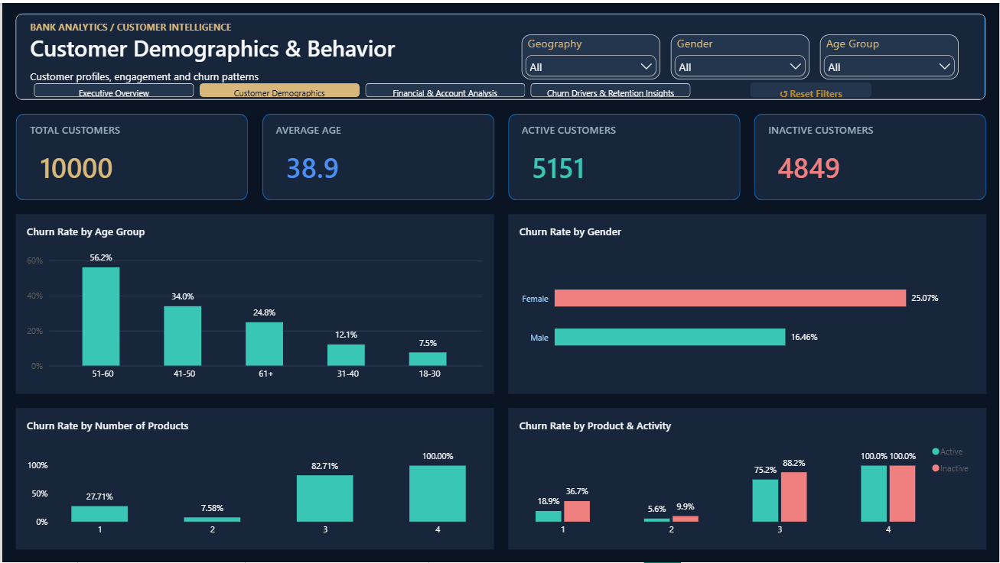
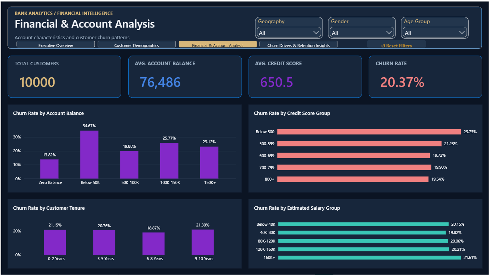
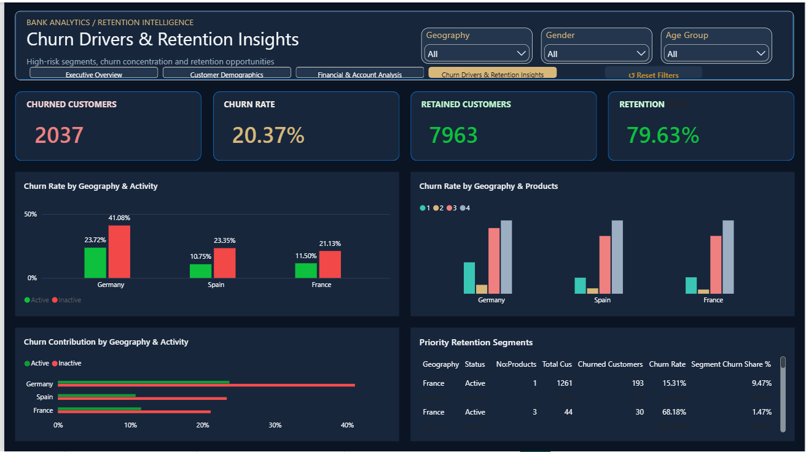

# Bank Customer Churn Analysis

### End-to-End Data Analytics Project | Python • PostgreSQL • Power BI

## Project Overview

This project analyzes a dataset of **10,000 bank customers** to understand customer churn, identify high-risk segments, and develop data-driven customer retention recommendations.

The project follows an end-to-end analytics workflow involving data cleaning, exploratory data analysis (EDA), SQL analysis, data modeling, DAX calculations, interactive Power BI dashboards, and business insights.

## Business Problem

Customer churn can affect a bank's long-term revenue and customer relationships. Understanding which customer segments experience higher churn helps businesses prioritize customer research and retention initiatives.

This analysis addresses the following questions:

- What is the overall customer churn rate?
- Which geographic regions experience the highest churn?
- How does churn vary by customer demographics?
- What relationships exist between churn and customer activity, account balances, credit scores, tenure, and product ownership?
- Which customer segments should be prioritized for further investigation?

## Tools and Technologies

| Tool | Purpose |
|---|---|
| Python | Data cleaning and exploratory data analysis |
| Pandas and NumPy | Data transformation and numerical analysis |
| Matplotlib and Seaborn | Exploratory visualizations |
| PostgreSQL | SQL-based customer churn analysis |
| Power BI Desktop | Interactive dashboards and data modeling |
| Power Query | Data preparation |
| DAX | KPI measures and analytical calculations |
| VS Code and Jupyter Notebook | Python development and documentation |
| Git and GitHub | Version control and portfolio publication |

## Analytics Workflow

**Raw Dataset → Python Data Cleaning → Exploratory Data Analysis → PostgreSQL SQL Analysis → Power BI Data Modeling → DAX Measures → Interactive Dashboards → Business Insights**

### 1. Data Cleaning

Prepared the bank customer dataset for analysis by checking data types, missing values, duplicates, categorical consistency, and data quality.

### 2. Exploratory Data Analysis

Explored customer churn patterns across geography, gender, age, account activity, product ownership, and financial characteristics.

### 3. SQL Analysis

Used PostgreSQL to analyze customer distributions, churn rates, geographic differences, customer activity, and high-risk segments.

### 4. Power BI Development

Developed a four-page analytical report with KPI measures, interactive charts, slicers, page navigation, and Reset Filters bookmarks.

## Key Performance Indicators

| KPI | Result |
|---|---:|
| Total Customers | 10,000 |
| Churned Customers | 2,037 |
| Retained Customers | 7,963 |
| Churn Rate | 20.37% |
| Retention Rate | 79.63% |
| Active Customers | 5,151 |
| Inactive Customers | 4,849 |

## Power BI Dashboard

### Page 1 — Executive Overview

### Page 2 — Customer Demographics

### Page 3 — Financial & Account Analysis

### Page 4 — Churn Drivers & Retention Insights

Identifies customer segments with elevated observed churn and supports retention prioritization.

## Key Business Insights

### 1. Germany Has the Highest Churn Rate

Germany has a churn rate of **32.44%**, compared with 16.15% in France and 16.67% in Spain.

This suggests Germany should be prioritized for further customer retention investigation.

### 2. Inactive Customers Have Higher Churn

Inactive customers show a churn rate of approximately **26.85%**, compared with 14.27% among active customers.

Customer engagement is an important area for further investigation and potential retention experiments.

### 3. Churn Differs Across Gender Groups

The observed churn rate is 25.07% among female customers and 16.46% among male customers.

Additional research is required to understand the reasons for this difference.

### 4. High-Risk Segment Identified

Inactive German customers holding one product have an observed churn rate of approximately **52.08%**.

This segment is a candidate for targeted customer research and controlled retention initiatives.

## Business Recommendations

1. Investigate the drivers of elevated churn in Germany.
2. Pilot customer re-engagement initiatives for inactive customers.
3. Evaluate product fit and service needs among single-product customers.
4. Monitor churn rates by geography, activity status, product count, and age group.
5. Validate retention strategies through controlled experiments and measurable business KPIs.

For the full analysis, see [Business Insights and Recommendations](Business_insights/Bank_Churn_Business_Insights.md).

## Project Limitations

The dataset represents a customer snapshot without a transaction timeline or historical churn events.

Therefore, the analysis identifies associations rather than causal relationships. Recommendations should be validated using additional customer information and controlled business experiments.

## Project Deliverables

- Cleaned analytical dataset
- Python cleaning and EDA notebooks
- PostgreSQL SQL analysis
- Power BI report with four dashboard pages
- DAX measures and interactive slicers
- Dashboard screenshots
- Business insights and recommendations
- GitHub project documentation

## Author

**Vijay V**